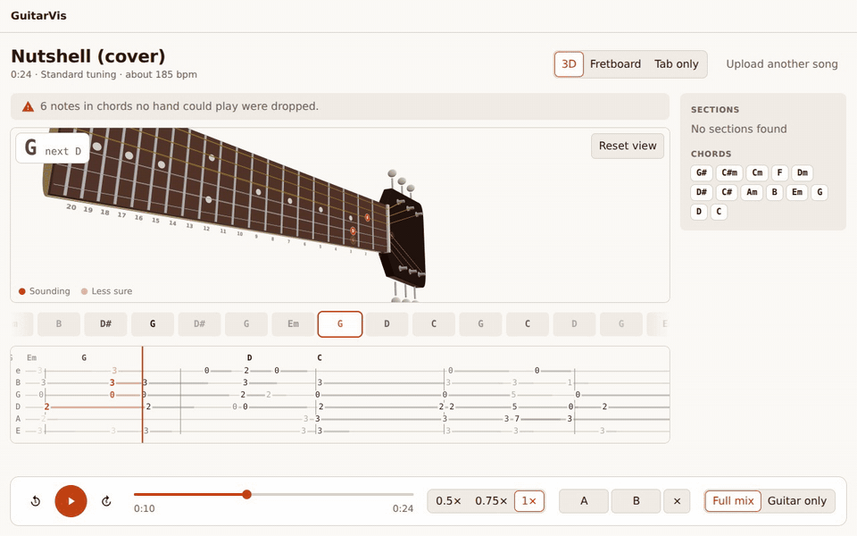
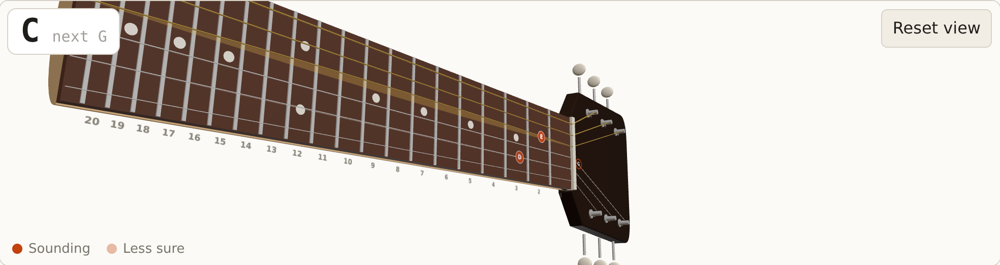
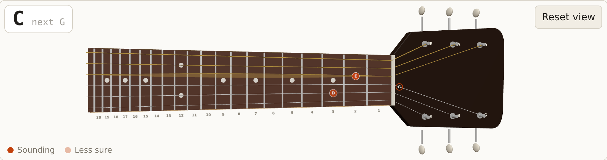
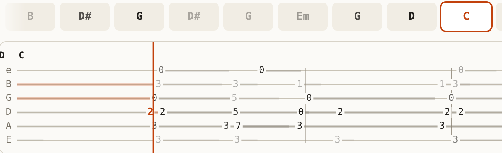
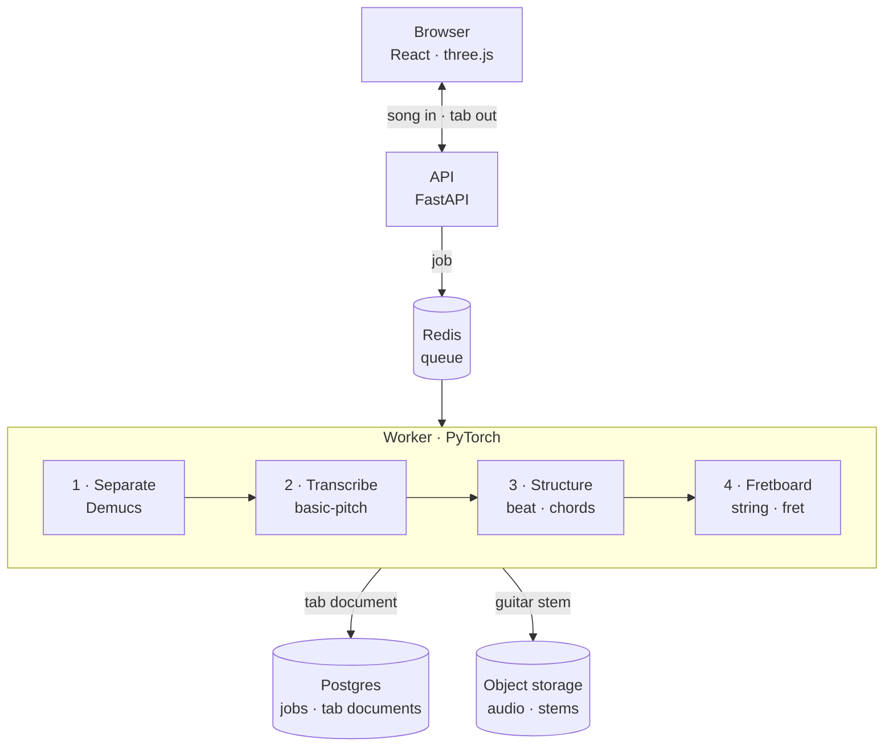
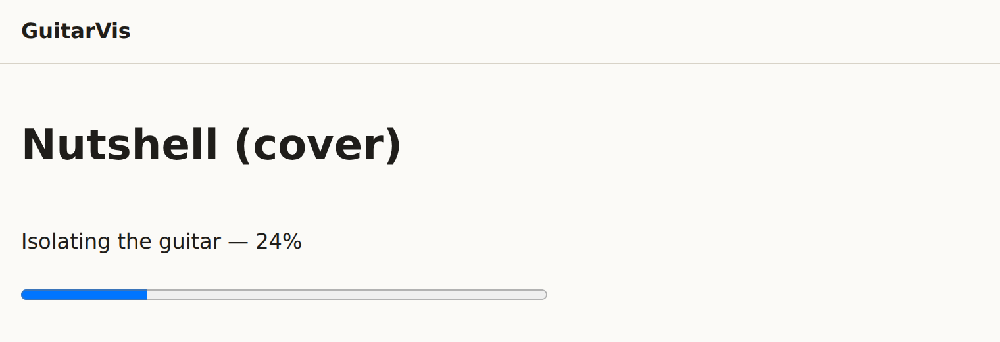
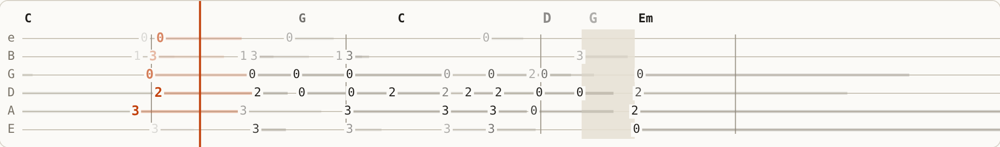

# GuitarVis

**Turn a song into guitar tab you can play along with.** GuitarVis takes a
recording or a YouTube link, separates the guitar from the band, works out
what it plays, and shows it on a 3D guitar, a fretboard and a scrolling tab,
all in sync with the music.

[](https://github.com/smadinya/GuitarVis/actions/workflows/ci.yml)




## What it does

| 3D guitar | Fretboard | Tab |
|---|---|---|
|  |  |  |

- **Bring a song.** Upload an audio file or paste a YouTube link.
- **The guitar is separated** from the vocals, drums and bass.
- **It becomes tab.** Every note gets a time, a string and a fret, along with
  the beat and the chords.
- **Practise with it.** Slow down to half speed without changing the pitch,
  loop a hard passage, or hear the guitar on its own.

The tour of every screen is in [Using the player](docs/guides/using-the-player.md).

## How it works



The API stays thin: it accepts the song, queues a job and serves results.
All the machine learning runs in a separate worker, in four stages. Each
stage sits behind a narrow interface, so it can be swapped or measured on its
own.

1. **Separate.** [Demucs](https://github.com/facebookresearch/demucs) splits
   the mix into six stems and keeps the guitar.
2. **Transcribe.** [basic-pitch](https://github.com/spotify/basic-pitch)
   turns the guitar stem into notes, each with a confidence.
3. **Structure.** Tempo, beats and chord symbols.
4. **Fretboard.** Deterministic code, not a model, chooses a string and fret
   for every note. It searches for the fingering that keeps the hand moving
   least.



Everything the player draws comes from one JSON **tab document**. A
different client, such as a phone app, would only need to render it.

## Engineering highlights

- **One contract, two languages.** The tab document is defined once in
  Python ([`tabdoc.py`](packages/core/src/guitarvis_core/tabdoc.py)) and
  published as [JSON Schema](schema/tab-document.schema.json). The client's
  TypeScript types are generated from it, and CI fails if any of the three
  drift apart.
- **The tab always matches the notes.** Every note leaving stage 4 is
  checked: its string and fret must produce exactly the pitch the
  transcriber heard
  ([`fretboard.py`](packages/core/src/guitarvis_core/fretboard.py),
  [ADR 0003](docs/decisions/0003-deterministic-fretboard.md)). Transcription
  can get a note wrong, but the fretboard stage never adds a second error on
  top of it.
- **Degrade, never fail.** A stage that breaks leaves its part out and the
  job carries on. Only "no usable guitar audio" fails a job outright.
- **Measured, not guessed.** Accuracy is measured against
  [GuitarSet](https://guitarset.weebly.com/) and every run is committed. On
  the test split (2026-10-20):
  - end to end, note F1 is **0.81** and string accuracy is **59%**
    ([full-mode results](eval/results/2026-10-20-7c8641c-full-test.json));
  - stage 4 alone, given the true pitches, puts **67%** of notes on the
    right string, against **38%** for always choosing the lowest fret
    ([oracle-mode results](eval/results/2026-10-20-7c8641c-oracle-test.json)).

  These numbers never gate CI
  ([ADR 0004](docs/decisions/0004-evaluation-is-measured-not-gated.md)): a
  model two points worse is a finding, not a broken build.
- **Boundaries enforced by tests.** The API may not import PyTorch or any ML
  library, and a test fails if it does
  ([`test_boundaries.py`](apps/api/tests/test_boundaries.py)). YouTube
  downloading runs in its own child process, behind a switch that turns it
  off ([ADR 0010](docs/decisions/0010-yt-dlp-in-a-child-behind-a-switch.md)).
- **Spec first.** Every feature began as a numbered design and plan in
  [`docs/specs/`](docs/specs/). Decisions and their alternatives are in
  [`docs/decisions/`](docs/decisions/).

## Honest limitations

Reading a guitar part off a full mix, down to string and fret, is not a
solved problem. Expect about **70–85% of notes right on clean recordings**,
and fewer on dense mixes.

Instead of hiding this, the player shows it. Unsure notes are drawn faded,
and runs of them are hidden behind the chord they belong to, so a guess never
looks like a fact. A beginner can't tell a wrong tab from a hard passage, and
would conclude they are bad at guitar. That silent wrongness is what the
design is built to avoid.



There is no editing yet, so a wrong note can't be corrected by hand.

## Quick start

You need [uv](https://docs.astral.sh/uv/), Node 22+, Docker and ffmpeg.
Pasting YouTube links also needs Deno.

```bash
git clone https://github.com/smadinya/GuitarVis.git
cd GuitarVis
make install && uv sync --extra ml   # packages, including the ML extra
make services && make migrate        # Postgres, Redis and storage in Docker
make api                             # then, in two more terminals:
make worker
make web                             # open http://localhost:5173
```

| Guide | For |
|---|---|
| [Run it locally](docs/guides/run-locally.md) | Each step explained, the first-run download, stopping, troubleshooting |
| [Using the player](docs/guides/using-the-player.md) | A screenshot tour: views, looping, speed, keyboard shortcuts, confidence |
| [From the command line](docs/guides/command-line.md) | The pipeline on one file, its JSON output, and the HTTP API with curl |

`make check` runs everything CI runs, and `make help` lists every command.

## Repository layout

| Path | What lives there |
|---|---|
| `packages/core` | The tab document, the stage interfaces, the fretboard invariant |
| `packages/jobs` | The job record, object storage and the queue, shared by the API and the worker |
| `packages/fetch` | Links: parsing, the yt-dlp child process and the failure catalog |
| `apps/api` | FastAPI. No ML code, enforced by test |
| `apps/worker` | The pipeline. The only part that needs PyTorch |
| `apps/eval` | The GuitarSet evaluation harness |
| `web` | React + TypeScript client, with three.js for the guitar |
| `schema` | Generated JSON Schemas: the cross-language contract |
| `eval/results` | Every committed evaluation run |
| `docs/specs` | One numbered folder per feature: `spec.md`, `plan.md` |
| `docs/decisions` | Architecture decision records |
| `docs/guides` | The guides above |

## Documentation

- [Design spec](docs/specs/001-guitarvis-design/spec.md): the whole system,
  including the decisions still open
- [Contributing](CONTRIBUTING.md): workflow and commands
- [Conventions](docs/CONVENTIONS.md): how the code is written
- [Decisions](docs/decisions/): what was chosen and why

## Licence

See [LICENSE](LICENSE).
