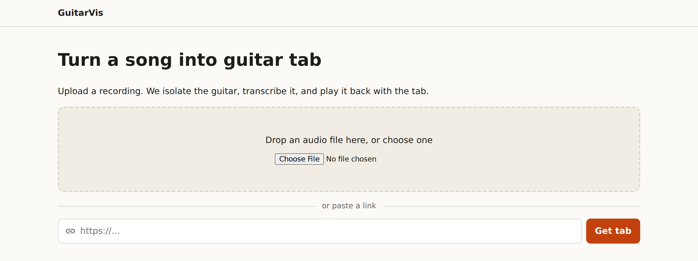

# Run it locally

From a clean clone to a song playing in your browser. Most of the time is
downloads, several GB of them, so it depends on your connection.

> **Verified on** Ubuntu 24.04 under WSL2, 2026-11-10. Every command below
> was run from a fresh clone, in this order. The record is in
> [`docs/specs/013-readme-showcase/acceptance.md`](../specs/013-readme-showcase/acceptance.md).
> For other platforms, use each tool's own install page.

## What you need

| Tool | Why | Install |
|---|---|---|
| [uv](https://docs.astral.sh/uv/getting-started/installation/) | Python packages and Python itself | uv picks up Python 3.12, which the repo pins in `.python-version`, and downloads it if you don't have it |
| [Node.js](https://nodejs.org/en/download) 22+ | The web client | |
| [Docker](https://docs.docker.com/get-started/get-docker/) | Postgres, Redis and S3-compatible storage | Docker Desktop on macOS and Windows |
| [ffmpeg](https://ffmpeg.org/download.html) | `ffprobe` reads uploaded audio | |
| [Deno](https://docs.deno.com/runtime/getting_started/installation/) 2.3+ | Only for pasting YouTube links | Optional |

## 1. Install

```bash
git clone https://github.com/smadinya/GuitarVis.git
cd GuitarVis
make install          # Python and Node packages, and the git hooks
uv sync --extra ml    # PyTorch, Demucs and basic-pitch, for the worker
```

The ML extra is large. On Linux it brings PyTorch's CUDA builds, and the
environment comes to about 6 GB on disk. It is separate so that the API and
CI never need it.

> **Running `make install` again removes the ML extra.** `uv sync` makes the
> environment match exactly what you asked for, and `make install` doesn't
> ask for `ml`. Run `uv sync --extra ml` again afterwards.

## 2. Start the services

```bash
make services   # Postgres, Redis and RustFS in Docker; waits until healthy
make migrate    # creates the jobs table and the storage bucket
```

## 3. Run the app

Each of these runs until you stop it, so give each its own terminal:

```bash
make api      # http://localhost:8000
make worker   # runs the pipeline on queued jobs
make web      # http://localhost:5173
```

Open **http://localhost:5173** and drop in a song.



The song page shows each stage as it runs, then the player. What you can do
there is in [Using the player](using-the-player.md).

**The first job downloads model weights.** That is about 55 MB of Demucs
weights, into `~/.cache/huggingface`. On this machine's CPU, a 25-second clip
took 48 seconds the first time and about 20 seconds after that. Time grows
with the length of the song, and separation is most of it.

**With an NVIDIA GPU**, `make worker ARGS="--device cuda"` runs the models on
it. *Not verified here: the test machine has no working GPU.*

## 4. Paste YouTube links (optional)

`make api` and `make worker` turn links on. They work only if Deno is on the
`PATH` of **both** terminals. Deno's installer puts it in `~/.deno/bin`,
which a new shell may not have on its `PATH`:

```bash
export PATH="$HOME/.deno/bin:$PATH"
deno --version   # 2.3 or later
```

Restart `make api` and `make worker` after that. To check that YouTube
fetching works from your machine, run:

```bash
make smoke-url   # downloads one Creative Commons video
```

## 5. Stop and clean up

Press Ctrl-C in the three terminals, then:

```bash
docker compose stop     # stops the services; your songs are kept
docker compose down -v  # also deletes the database and every uploaded song
```

## Troubleshooting

**`make services` fails with `port is already allocated` or `address already in use`.**
Something else is using one of the ports. The first message means another
Docker container has it, such as the stack from another GuitarVis checkout:
`Bind for 127.0.0.1:5432 failed: port is already allocated`. The second
means a program outside Docker has it, such as a local Postgres. The stack
needs 5432, 6379, 9000 and 9001. Stop the other one (for another checkout,
`docker compose stop` in its folder) and try again.

**`uv sync --extra ml` fails while building numpy.** uv is using Python
3.13 or later, where the pinned numpy has no prebuilt wheel. The repo pins
3.12 in `.python-version`, so something is overriding it, usually a
`UV_PYTHON` environment variable. Unset it, or run
`uv sync --extra ml --python 3.12`.

**A job fails with `No module named demucs`, or `torch` is missing.** The
ML extra is not installed. This usually happens after re-running
`make install`. Run `uv sync --extra ml`, then restart `make worker`.

**Pasting a link says "We can't fetch from YouTube at the moment".** Deno
is not on the `PATH` of `make api`. The api looks the link up before it
queues the job. The worker logs the same thing at start:
`links are on, but Deno 2.3.0 or later was not found`. See step 4.

**The api errors about a missing column, such as `source_url`.** Your
database predates the latest migration. Run `make migrate`.

**Run the checks.** `make check` is what CI runs: lint, type checks, the
Python and web test suites, and the contract drift check. With the services up, set
`GUITARVIS_REQUIRE_SERVICES=1` so that no integration test skips silently.
