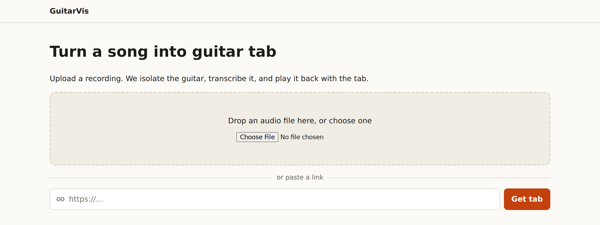
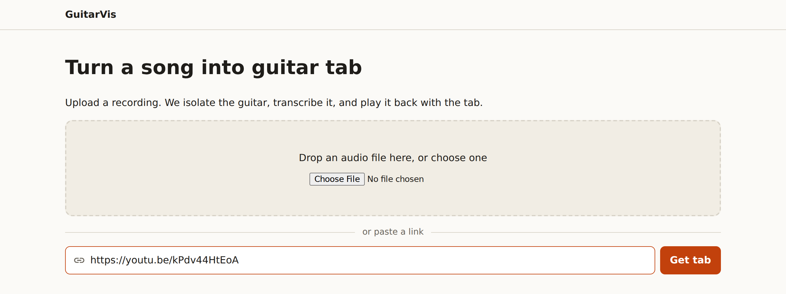
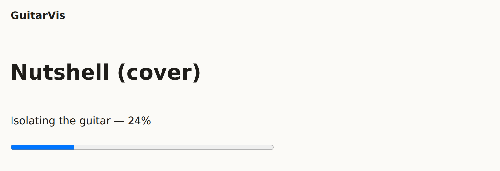
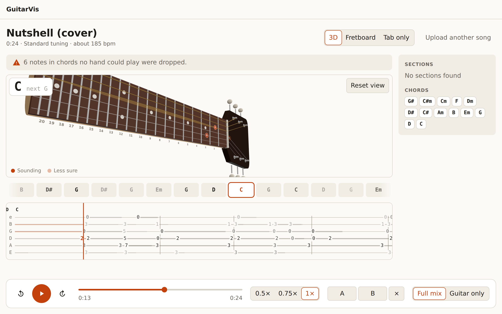
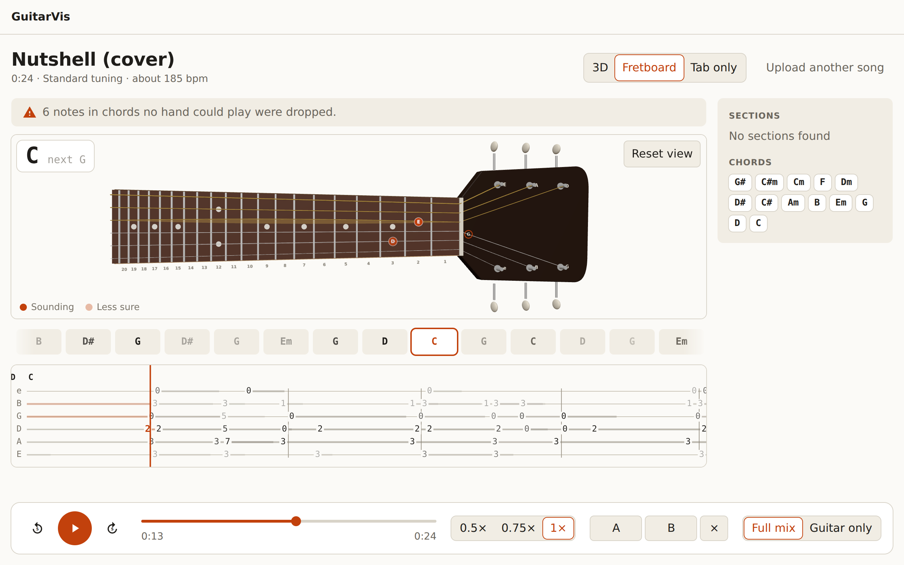
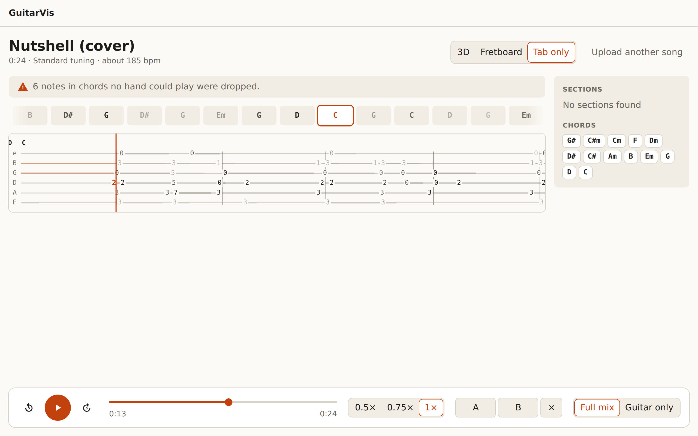
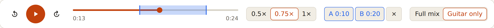
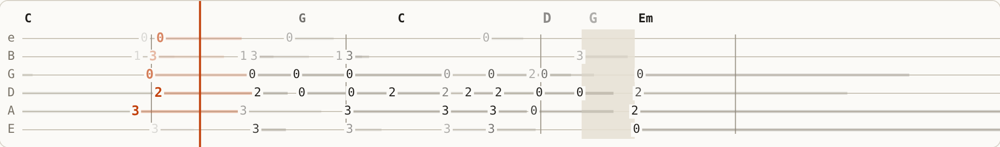
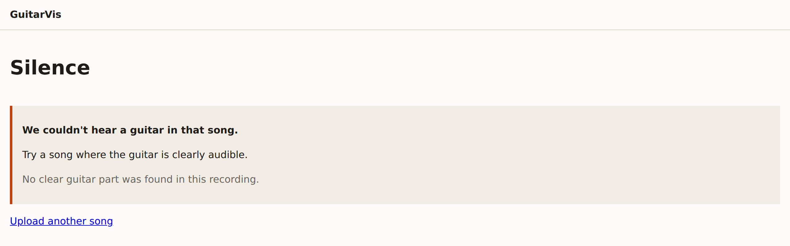

# Using the player

A tour of the app, in the order you meet it. Every screenshot is the real
app playing the owner's cover of *Nutshell*. To get it running, see
[Run it locally](run-locally.md).

## 1. Give it a song

Drop an audio file on the page or choose one: MP3, WAV, FLAC or M4A, up to
ten minutes long.

Or paste a link to a single YouTube video and press **Get tab**. This needs
links turned on and Deno installed; see
[Run it locally](run-locally.md#4-paste-youtube-links-optional).

Giving it the same song again, or the same video through any form of its
link, opens the existing result instead of processing it again.

## 2. Wait for the four stages

The song page shows which stage is running and how far it has got:

| Label | What is happening |
|---|---|
| *Waiting for a worker* | The job is queued |
| *Fetching the audio* | Links only: downloading the video's audio |
| *Isolating the guitar* | Demucs separates the guitar from the mix. This is the slow part. |
| *Transcribing notes* | basic-pitch turns the guitar stem into notes |
| *Finding the beat and chords* | Tempo, bars and chord symbols |
| *Working out fingerings* | Each note gets a string and a fret |

A stage that fails is left out, and the job carries on without its part.
If the whole job crashes, it is retried twice, and the page says
*Retrying — attempt 2 of 3*.

## 3. Play along

From the top down:

- **The header** shows the title, then the length, tuning and tempo. The
  **3D · Fretboard · Tab only** switch changes the view. The browser
  remembers your choice.
- **Warnings**, when there are any. The example here: notes in chords no
  hand could play were dropped rather than shown on a wrong fret.
- **The guitar.** Notes light up on the string and fret to play them. A
  solid dot is *Sounding*; a pale one is *Less sure*. The box in the corner
  shows the chord now and the next one. Drag to turn the 3D guitar, or to
  pan the flat fretboard; **Reset view** puts the camera back.
- **The chord lane.** The current chord is outlined.
- **The tab strip.** Six lines, high e at the top. The numbers are frets,
  the bar after each one is how long it rings, and the red line is now.
- **Sections and chords**, at the right. Click a section to jump to it.

The same moment in the other two views, **Fretboard** and **Tab only**:

## 4. Practise a passage

The transport, from the left:

- Back 5 seconds, **play / pause**, and forward 5 seconds.
- **The scrubber.** Click or drag anywhere. When it has focus, the arrow
  keys, Home and End work too.
- **0.5× · 0.75× · 1×** slows the song down without changing its pitch.
  It appears only when the browser can do this.
- **A** and **B** set a loop's start and end at the current moment, and
  then show its times. **×** clears the loop.
- **Full mix · Guitar only** switches between the original and the
  separated guitar.

Keyboard shortcuts:

| Key | Does |
|---|---|
| Space | Play / pause |
| ← / → | Back / forward 5 seconds |
| `[` / `]` | Set the loop's start / end here |

## 5. Read the confidence

Transcription is not always right, so the player shows where it is unsure.
Notes the transcriber is unsure of are drawn **faded**. When three or more
unsure notes come together, the passage is **hidden** behind a shaded box,
and the chord stands in for it. A guess is never shown as if it were
certain.

The thresholds come from measurement, not judgement by eye. See
[calibration.md](../specs/006-tab-view-sync/calibration.md).

## When a song fails

A failed job says why, and what to try instead:

| Message | Usually means |
|---|---|
| *We couldn't hear a guitar in that song.* | No clear guitar part: silence, or a recording without a guitar in it |
| *We couldn't read that file as audio.* | Not an audio file, or a format ffmpeg can't read |
| *That recording is too long.* | Over ten minutes |
| *We couldn't fetch that audio.* | YouTube refused or changed; try again later, or upload the file |
| *We can't use that video.* | The video is private, members-only, age- or region-restricted, live, or has no audio |
